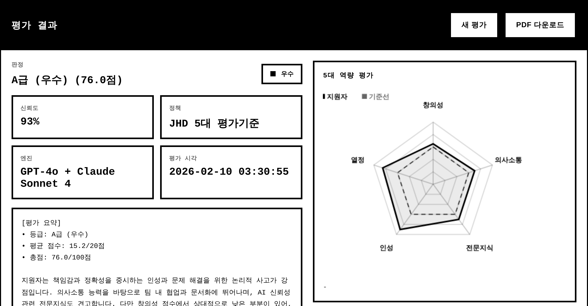
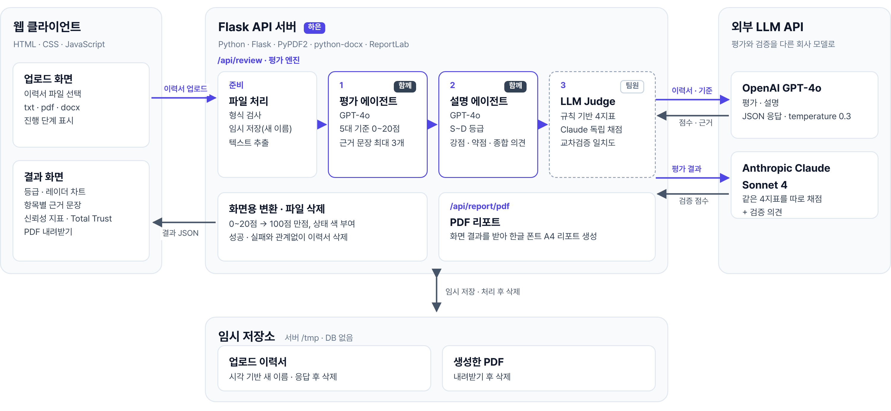
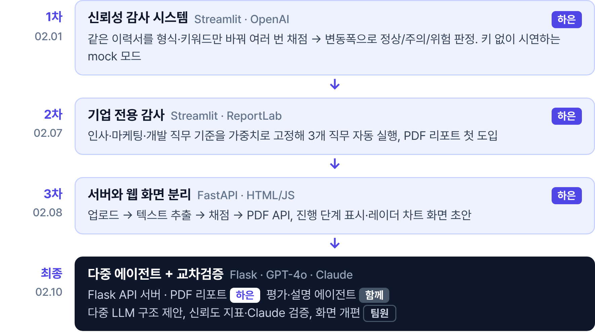
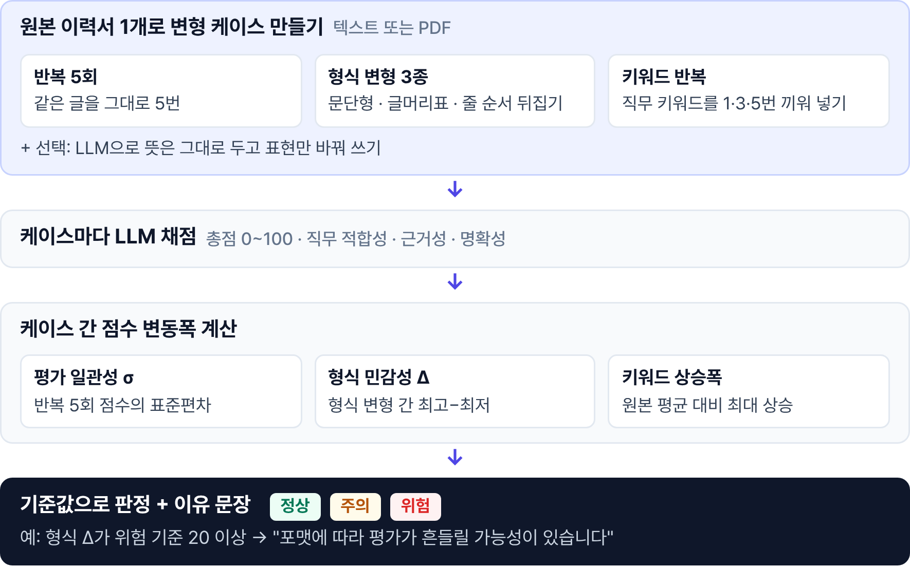
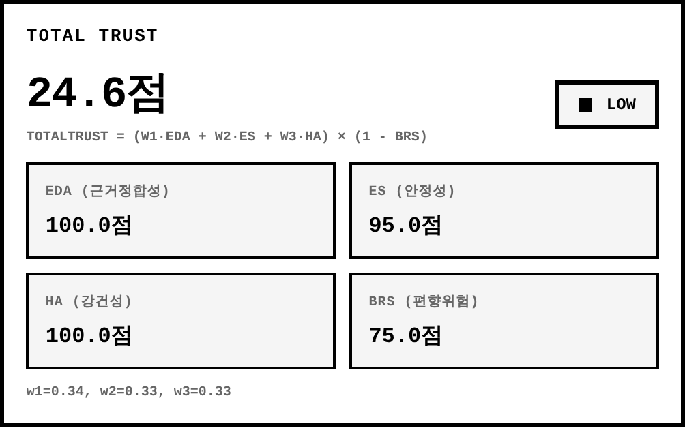
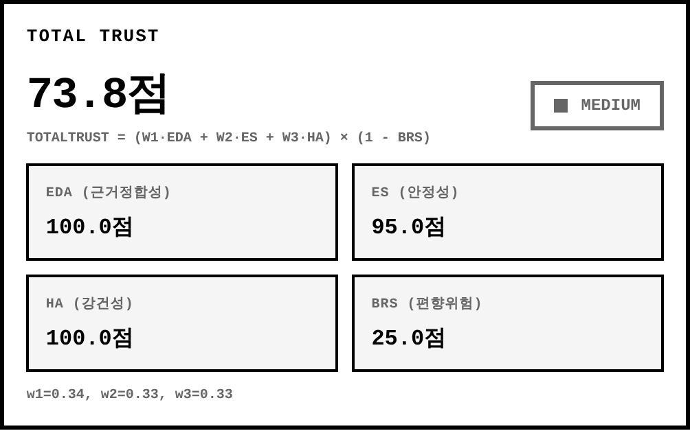

# AI 채용 평가 - 신뢰도 기반 다중 에이전트 AI 채용 평가 시스템

**점수가 아니라 신뢰를 평가합니다.**
이력서를 GPT-4o가 회사 기준으로 채점하고, 규칙 기반 지표와 Claude가 그 채점을 다시 검증해 평가 신뢰도까지 함께 보여 주는 AI 서류 평가 시스템입니다.

- 생성형 AI+X 활용 아이디어 경진대회 **최우수상(2등)** · 경상국립대 RISE사업단
- 2025.12 ~ 2026.02 · 팀 2인



## 전체 구조



| 단계 | 하는 일 |
|---|---|
| 평가 에이전트 (GPT-4o) | 회사 5대 기준(창의성 · 의사소통 · 전문지식 · 인성 · 열정)마다 0~20점 + 이력서 속 근거 문장 최대 3개 |
| 설명 에이전트 (GPT-4o) | 평균 점수로 S~D 등급, 강점 · 약점 2개씩, 평가 요약과 종합 의견 |
| LLM Judge | 규칙 기반 신뢰도 4지표(근거정합성 · 안정성 · 강건성 · 편향위험) + Claude Sonnet 4 독립 채점 → 교차검증 일치도 |
| Flask API 서버 | 파일 검사 · 텍스트 추출(txt · pdf · docx) · 평가 실행 · 화면용 변환 · PDF 리포트, 처리 후 업로드 파일 삭제 |

5대 기준은 시연용 가상 기업 JHD가 정한 채점 기준표이며, 기준 이름 · 설명 · 키워드를 바꾸면 다른 회사 기준으로 평가할 수 있습니다.

## 폴더 구조

```
backend/
  flask_api_server.py                           API 서버 (/health · /api/review · /api/report/pdf)
  resume_evaluation_system_cross_validation.py  평가 엔진 (평가 · 설명 에이전트, LLM Judge)
  requirements.txt
  .env.example
frontend/
  index.html                                    업로드 · 진행 단계 · 결과 화면
prototypes/                                     최종 버전 이전의 프로토타입
  v1_audit_page.py          1차 · 신뢰성 감사 (Streamlit)
  v2_company_audit_page.py  2차 · 직무별 기업 전용 감사 + PDF
  v3_server.py, v3_home.html  3차 · FastAPI 서버 + 웹 화면 초안
docs/images/
```

## 실행

```bash
cd backend
pip install -r requirements.txt
cp .env.example .env   # OPENAI_API_KEY, ANTHROPIC_API_KEY 입력
python flask_api_server.py   # http://127.0.0.1:5001
```

`frontend/index.html`을 브라우저로 열면 위 서버에 연결됩니다.

## 버전 흐름



1차 프로토타입은 같은 이력서를 반복 · 형식 변형 · 키워드 반복으로 여러 번 채점해 점수 변동폭으로 평가 신뢰성을 판정합니다.



## Total Trust 계산 수정

서버의 `편향위험`은 높을수록 안전한 점수(100 − 위험도)인데, 화면의 Total Trust 공식은 이를 위험도로 보고 `(1 − 편향위험)`을 곱하고 있었습니다. 공식에 넣기 전에 위험도로 되돌리도록 수정했습니다.

| 수정 전 | 수정 후 |
|---|---|
|  |  |

## 역할

| | 담당 |
|---|---|
| 장하은 | 기획 · 1~3차 프로토타입 · Flask API 서버 · PDF 리포트 · 평가/설명 에이전트(공동) · 발표 |
| 팀원 | 다중 LLM 구조 제안 · 신뢰도 지표 · Claude 교차검증 · 화면 개편 |

## 기술

Python · Flask · OpenAI GPT-4o · Anthropic Claude Sonnet 4 · PyPDF2 · python-docx · ReportLab · HTML/JS · (프로토타입) Streamlit · FastAPI
